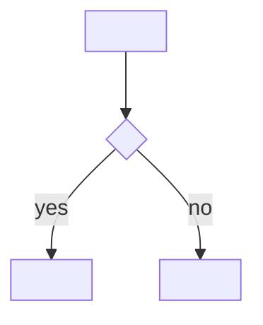

# <Feature name>: PRD

<!-- What and why, from the user's point of view. No technical terms: no endpoints, tables, components or libraries. About 150 lines at most. Delete these comments. -->

## Context

<!-- What is missing or painful today, for whom, and why it matters. -->

## Users

<!-- Who does what, in plain nouns. -->

- **<User>**: <what they do in this feature>

## Flow

1. <One action or decision per step>
2. ...

## Rules

<!-- Grouped per action. Each rule must be testable: someone can check whether it holds. -->

### <Action, e.g. Adding a note>

- <Rule>

## Out of scope

- <Thing we won't do>: <one-line reason>

## Open questions

- <Functional question still to answer>
