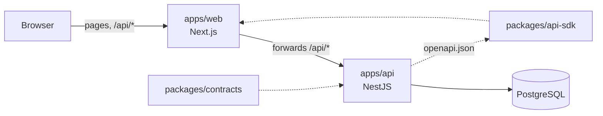

# Architecture overview

A monorepo with a website, an API and a database. The folders are listed in the README. This page explains how the parts work together.

## Requests

The browser only talks to the website. The website forwards every `/api/*` request to the API (`apps/web/next.config.ts`), so the browser sees one address and the login cookie works without extra setup. The website runs entirely in the browser: pages load their data from the API after they open.

## Data shapes: contracts to SDK

1. A shape is defined once as a Zod schema in `packages/contracts`.
2. The API uses it to validate requests and responses (nestjs-zod).
3. `pnpm generate:sdk` builds the API, writes its OpenAPI description to `apps/api/openapi.json`, and generates a typed client in `packages/api-sdk`.
4. The website calls the API only through that client.

A change to a shape is therefore checked by TypeScript in both the API and the website.

## Login

better-auth runs inside the API. It stores users, passwords (hashed) and sessions in the database and keeps the session in a cookie. Routes that need a user use `AuthGuard`. The capability itself is described in [login](../features/login.md).

## Database

PostgreSQL, accessed through Prisma. The schema is `apps/api/prisma/schema.prisma`, changes go through migrations in `apps/api/prisma/migrations/`, and `prisma/seed.ts` creates the admin user.

## Running it

Turborepo runs tasks across the packages in dependency order and caches the results (`turbo.json`). The app runs either on the laptop (`pnpm dev`, with the database in Docker) or entirely in Docker (`docker compose --profile app up`). See the README.
